# Power Supply Cases

## Delta iMac 27″ Late 2015 Power Supply

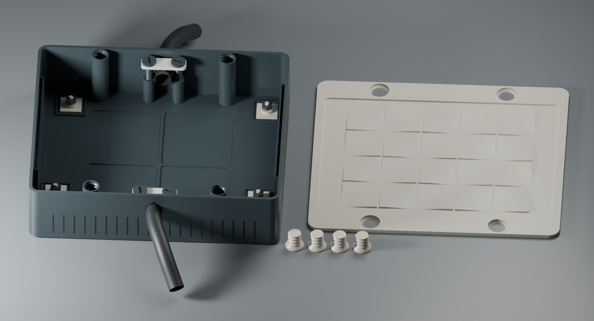

[AURA S-60-12](#aura-s-60-12) · [AURA Compact 160](#aura-compact-160) · [Suncronizer](#suncronizer) · [P1S settings](#printing-on-the-p1s)

Enclosure for the **Delta ADP-300AF T**, the 300 W power supply in the 27-inch Retina 5K iMac (Late 2015). The board mounts on four adjustable shoes. The finished case measures **190 × 166 × 50 mm**, including the feet.

[Print ZIP](https://github.com/vluncasu/power-supply-cases/releases/latest/download/imac-27-5k-2015-print.zip) · [CAD + print ZIP](https://github.com/vluncasu/power-supply-cases/releases/latest/download/imac-27-5k-2015-cad.zip) · [Graphite plate ×13](cases/imac-27-5k-2015/print/plates/01-graphite-13.3mf) · [Ivory plate ×11](cases/imac-27-5k-2015/print/plates/02-ivory-11.3mf)

| Bare base | Interior with supports and clamps |
|---|---|
| 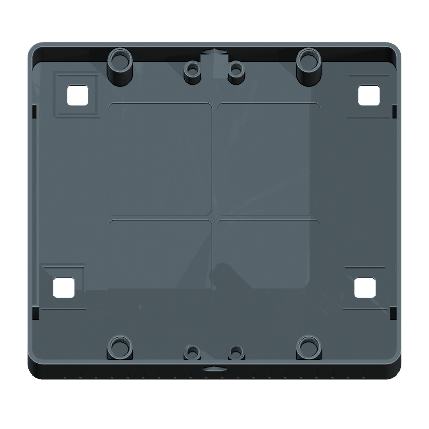 |  |

Four printed feet lock the sliding PCB supports from below. The raised strips along the sidewalls shield the vent openings. Each end has a saddle and two threaded posts for the cable clamp.

### How the iMac board is held

| Lid post | Board mount | Cable saddle |
|---|---|---|
| 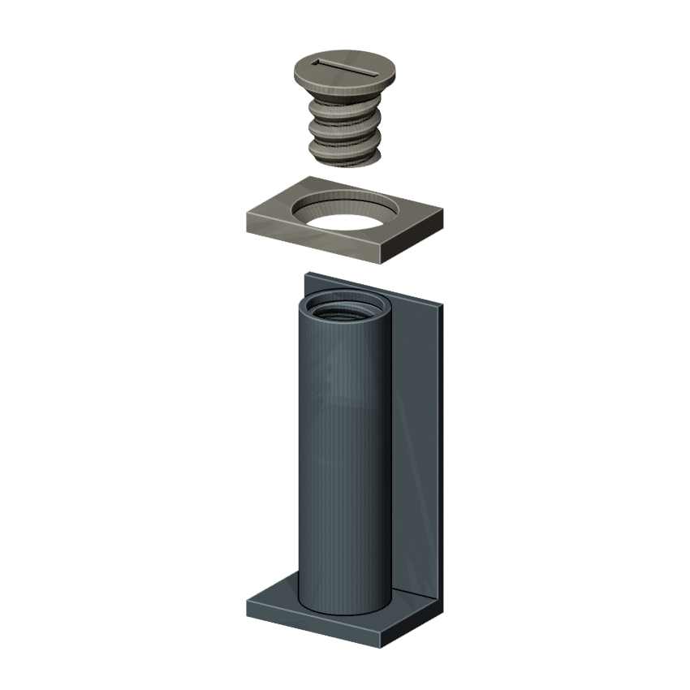 | 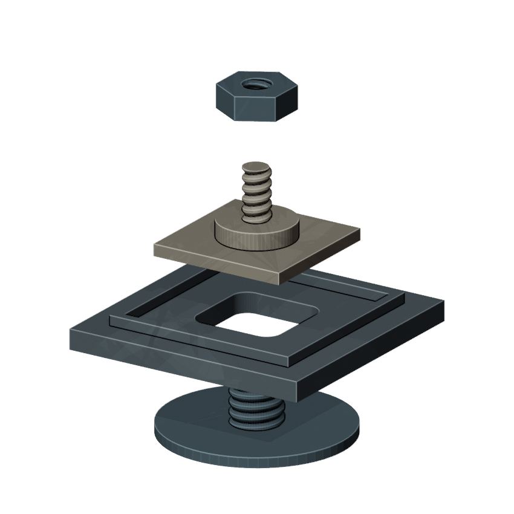 | 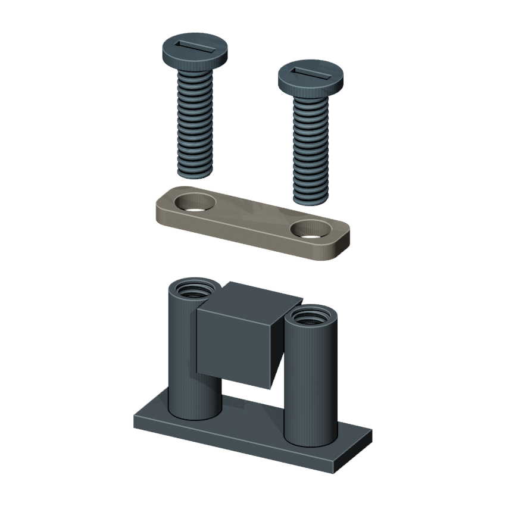 |

The **locking foot (05)** threads into the shoe from beneath the floor. Align all four shoes before tightening the feet. The PCB mounting ring sits between the shoe shoulder and **nut (06)**. The gaps in these exploded views are enlarged for visibility.

| Lid screw · 03 | Sliding shoe · 04 | Locking foot · 05 |
|---|---|---|
| 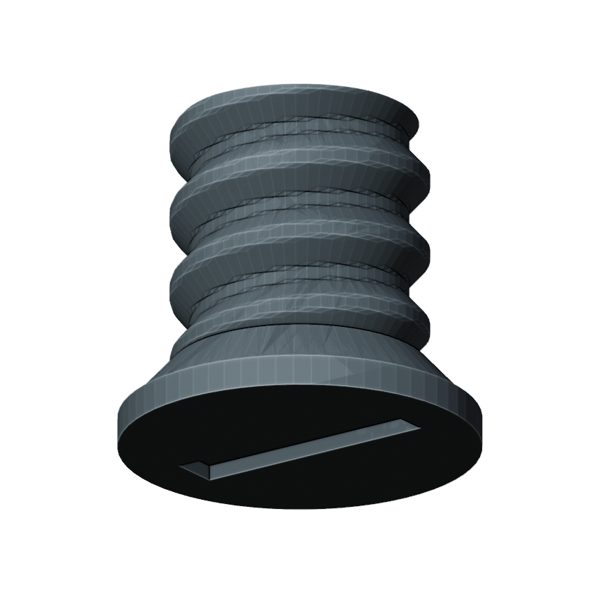 | 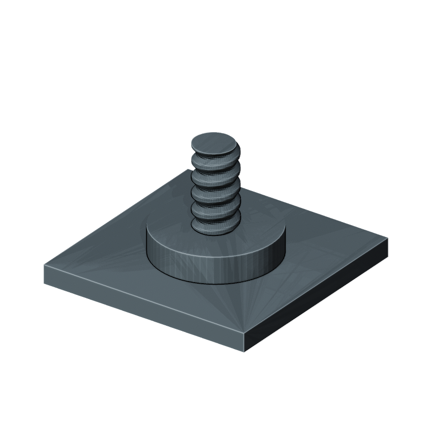 | 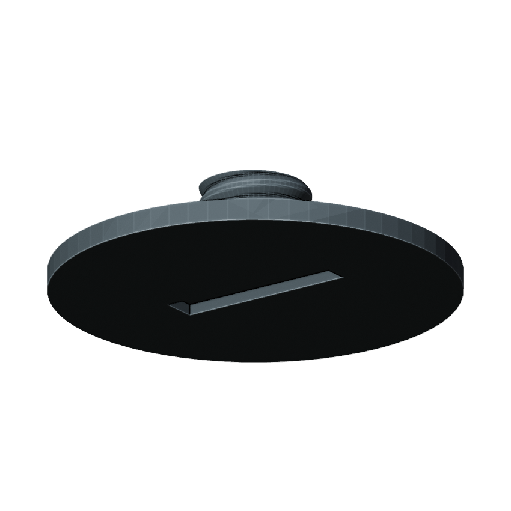 |
| **PCB nut · 06** | **Cable clamp · 07** | **Clamp screw · 08** |
| 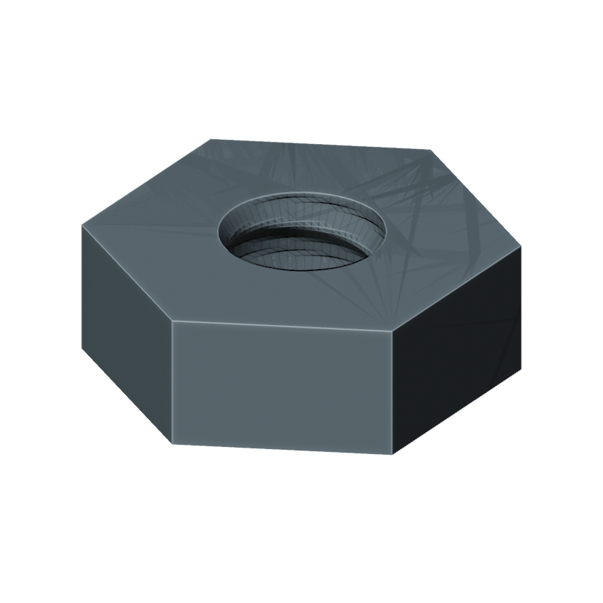 | 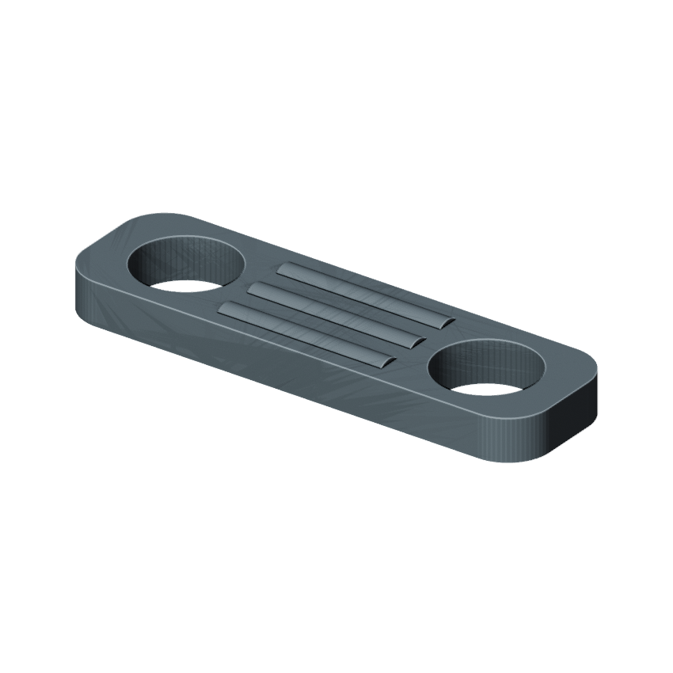 | 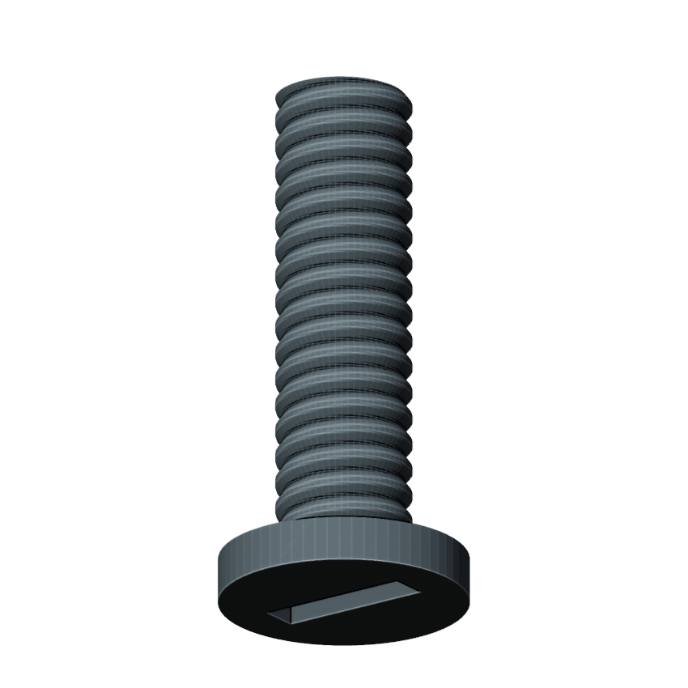 |

Part numbers match the STL filenames. The lid screws have 14 mm heads and 3 mm pitch. The longer clamp screws have 11 mm heads and 1.2 mm pitch. Two screws draw each clamp down onto the cable jacket.

| Closed | Opposite end | Lid removed from posts |
|---|---|---|
|  |  |  |

Dimensions, assembly sequence and individual STL downloads

### Board dimensions and mounting coordinates

Identify the supply by its manufacturer label before printing. Apple identifies the host computer as iMac17,1. The supplier lists Apple part 661-03524 for both Delta ADP-300AF T and Lite-On PA-1311-2A supplies. Mechanical fit was studied for the Delta board only. [Apple model identification](https://support.apple.com/en-gb/108054) · [Supplier part record](https://beetstech.com/product/imac-27-inch-a1419-300w-power-supply-661-03524)

The photographic estimate is **163 ± 1 mm long, 132 ± 2 mm wide and 30 ± 5 mm high**. The design envelope allows 164 × 134 mm in plan and 35 mm above the mounting plane. Check the tallest heatsink and the solder joints below the board independently.

The 99 mm dimension is the vertical distance between mounting rows. The 3.4 mm underside gap is measured from the inner floor surface to the PCB support plane.

| Mount | X from left edge (mm) | Y from top edge (mm) |
|---|---:|---:|
| A | 12 | 3 |
| B | 160 | 3 |
| C | 5 | 102 |
| D | 158 | 102 |

The estimated uncertainty is ±2 mm per coordinate. Horizontal hole spacing is 148 mm in the upper row and 153 mm in the lower row. The rows are 99 mm apart vertically. Estimated hole diameters are 3.5–4 mm with an approximately 8 mm outer mounting ring. The four sliding shoes have 3.2 mm printed studs and 9 mm support pads.

### Height, airflow and material

The board plane is 5.8 mm above the exterior floor. The height budget is **5.8 + 35 + 5 = 45.8 mm** to the inner ceiling. The lid frame and feet bring the total to 50 mm. Above the 2.4 mm floor, the nominal underside gap is 3.4 mm. It is a mechanical allowance and requires checking against actual solder projections and electrical requirements.

Two rows of chevron slots feed baffled side passages. The 44 slots have a combined nominal opening of about 1,380 mm². The passages above the baffles provide about 1,040 mm². Airflow and operating temperatures have not been measured. The 20 curved lid tiles rise 1.2 mm above the skin. Total CAD solid volume is 249.93 cm³, a 33.18% reduction from the earlier SCULPT design. Sliced filament use depends on toolpaths. [CAD comparison](cases/imac-27-5k-2015/validation/comparison.json)

### Assembly sequence

1. Place the four shoes in their guides. Engage the locking feet from beneath and leave them loose enough to align.
2. Check each support against the actual board. Confirm that the underside clears the floor and that each pad contacts only a mounting area. Secure the feet and printed nuts gently. The short printed threads are sensitive to printer tolerances.
3. Place one jacketed cable on each saddle. Turn each clamp ribs-down and tighten its two screws evenly. The entry and exit are on opposite ends. CAD checks cover round jackets of 4, 6, 8, 10 and 12 mm through 12.6 mm ports. The renders illustrate 12 mm cables. Pull-out resistance has not been measured.
4. Fit the lid with its four recessed screws. Keep the side vents clear.

| Individual STL | Color | Quantity |
|---|---|---:|
| [Base](cases/imac-27-5k-2015/print/stl/graphite/01_base_x1.stl) | Graphite | 1 |
| [Relief lid](cases/imac-27-5k-2015/print/stl/ivory/02_relief-lid_x1.stl) | Ivory | 1 |
| [Lid screw](cases/imac-27-5k-2015/print/stl/ivory/03_lid-screw_x4.stl) | Ivory | 4 |
| [Xy pcb support](cases/imac-27-5k-2015/print/stl/ivory/04_xy-pcb-support_x4.stl) | Ivory | 4 |
| [Locking foot](cases/imac-27-5k-2015/print/stl/graphite/05_locking-foot_x4.stl) | Graphite | 4 |
| [Pcb nut](cases/imac-27-5k-2015/print/stl/graphite/06_pcb-nut_x4.stl) | Graphite | 4 |
| [Cable clamp](cases/imac-27-5k-2015/print/stl/ivory/07_cable-clamp_x2.stl) | Ivory | 2 |
| [Clamp screw](cases/imac-27-5k-2015/print/stl/graphite/08_clamp-screw_x4.stl) | Graphite | 4 |
| **Total** | | **24** |

[Edit this case in Blender or FreeCAD](cases/imac-27-5k-2015/cad/)

## AURA S-60-12

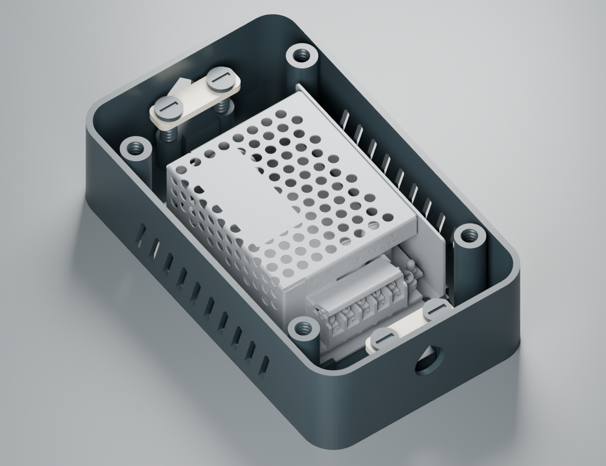

For the **86 × 58.02 × 33.02 mm** S-60-12 metal supply represented by the STEP reference. The case measures **148 × 88 × 42.8 mm**.

[Print ZIP](https://github.com/vluncasu/power-supply-cases/releases/latest/download/aura-s60-print.zip) · [CAD + print ZIP](https://github.com/vluncasu/power-supply-cases/releases/latest/download/aura-s60-cad.zip) · [Graphite plate ×5](cases/aura-s60/print/plates/01-graphite-5.3mf) · [Ivory plate ×7](cases/aura-s60/print/plates/02-ivory-7.3mf)

| Bare base | Underside of lid |
|---|---|
| 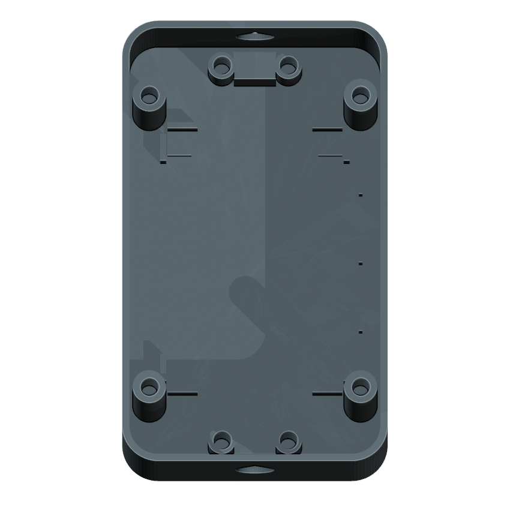 | 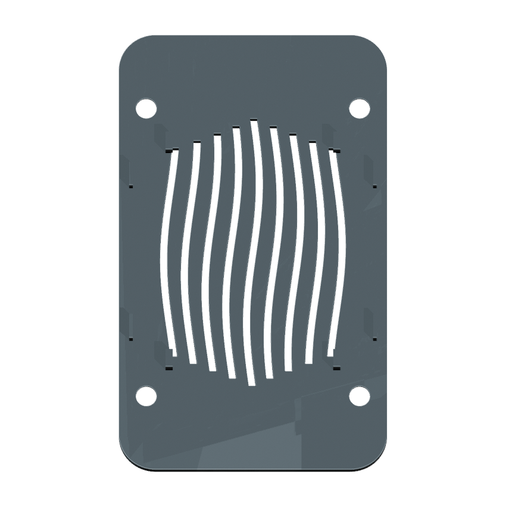 |

The housing sits on four floor pads with the terminals toward the cable entry. A guide beside the housing carries the DC lead to the opposite end.

Fixed pads on the lid sit over the folded metal edges. The calculated vertical play is 0.18 mm.

| Closed | Opposite end | Lid removed from posts |
|---|---|---|
|  |  |  |

Dimensions, assembly sequence and individual STL downloads

### Fit and assembly

The measured STEP envelope, including small projections, is **86 × 58.02 × 33.02 mm**. Those decimals describe the reference geometry. Check the metal housing and terminal location on the physical unit. The original reference contained 44 solids. [Reference interference check](cases/aura-s60/validation/reference_fit.json)

Keep the original metal shell in place and orient the terminals toward the AC end. Four pads support the shell. Stops limit lateral travel, and the closed lid leaves about 0.18 mm nominal vertical play at the upper stops. This small allowance makes actual dimensions and print tolerance particularly important.

Both ports are on opposite ends. The DC route beside the housing was designed for approximately 5–8 mm cable. Secure each jacket with a clamp, check the bend at the terminals, then install the four lid screws. Side intakes and the wavy lid openings provide an air path. Load temperature has not been measured.

The interior view shows the printed supports and both clamps with the reference supply hidden. The editable Blender file contains the five printable parts at their print origins. The supplier STEP is excluded from distribution.

| Individual STL | Color | Quantity |
|---|---|---:|
| [Body](cases/aura-s60/print/stl/graphite/01_body_x1.stl) | Graphite | 1 |
| [Wave lid](cases/aura-s60/print/stl/ivory/02_wave-lid_x1.stl) | Ivory | 1 |
| [Lid screw](cases/aura-s60/print/stl/ivory/03_lid-screw_x4.stl) | Ivory | 4 |
| [Cable clamp](cases/aura-s60/print/stl/ivory/04_cable-clamp_x2.stl) | Ivory | 2 |
| [Clamp screw](cases/aura-s60/print/stl/graphite/05_clamp-screw_x4.stl) | Graphite | 4 |
| **Total** | | **12** |

[Edit this case in Blender or FreeCAD](cases/aura-s60/cad/)

## AURA Compact 160

For a metal supply estimated at **110 × 100 × 36 mm**. The case measures **160 × 124 × 48.8 mm**.

[Print ZIP](https://github.com/vluncasu/power-supply-cases/releases/latest/download/aura-compact-160-print.zip) · [CAD + print ZIP](https://github.com/vluncasu/power-supply-cases/releases/latest/download/aura-compact-160-cad.zip) · [Black plate ×5](cases/aura-compact-160/print/plates/01-black-5.3mf) · [White plate ×9](cases/aura-compact-160/print/plates/02-white-9.3mf)

| Bare base | Underside of lid |
|---|---|
| 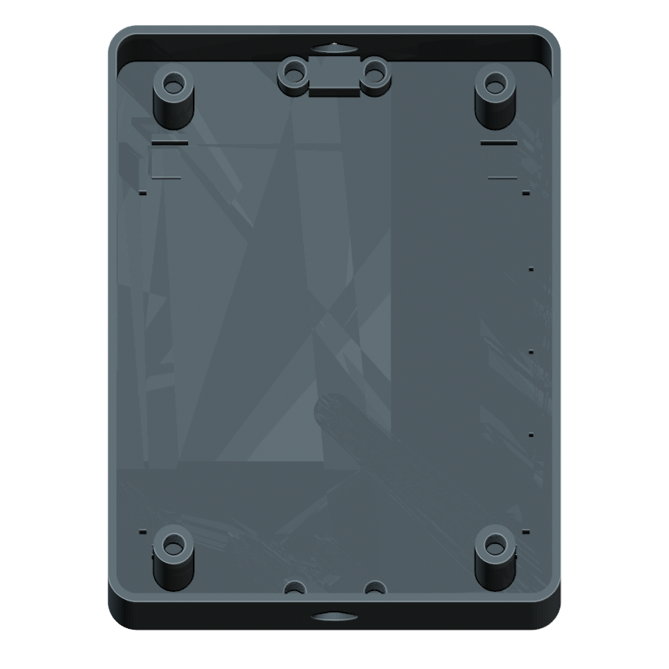 | 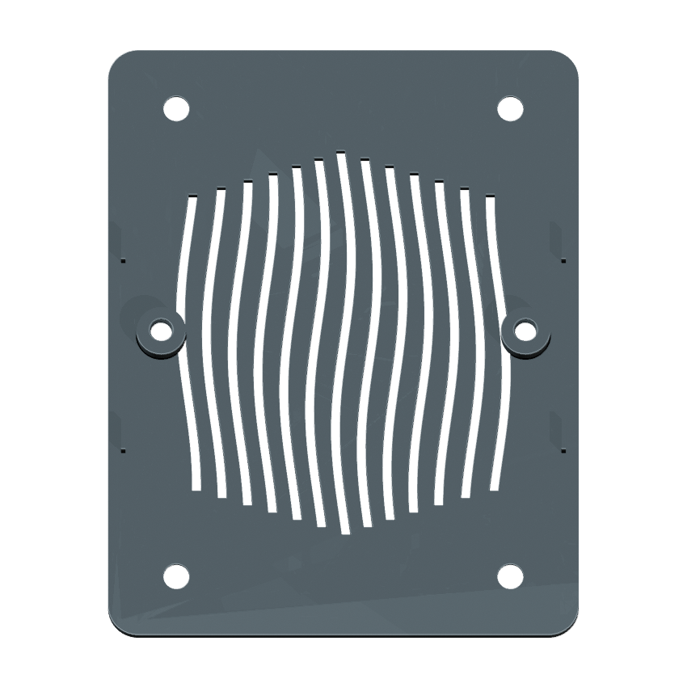 |

The floor pads support the metal case. The side stops set its position and the narrow channel beside them carries the DC lead. The gray block shows the envelope used for the fit check.

The two threaded bosses beside the vents carry the short hold-down screws. Their tips must bear on solid metal.

| Closed | Opposite end | Lid removed from posts |
|---|---|---|
|  |  |  |

Dimensions, assembly sequence and individual STL downloads

### Fit and assembly

The estimated metal housing is **110 × 98–100 × 35–36 mm**. Length has the greatest uncertainty. CAD checks use two envelopes, 110 × 100 × 36 mm and **112 × 102 × 38 mm**. Allow for any terminals or screw heads projecting beyond the metal housing. The adjustable hold-down screws may raise the total height to **50.8 mm** with the tallest unit.

The compact layout reduces the footprint by 18.3% compared with the earlier 184 × 132 mm body. The maximum PSU envelope leaves approximately **13.7 mm at the terminal end** before the cable saddle. The DC corridor narrows to about **5.2 mm** beside the guides. Check the actual cable bend along the whole route. [CAD comparison](cases/aura-compact-160/validation/comparison.json)

Place the metal-cased unit on the supports with its terminals toward the input. Fit both cable clamps and the four peripheral lid screws. The two short screws beside the lid vents take up vertical play. Their nominal contact points are X = ±48 mm and Y = −2 mm from the case center. Use them only where both tips meet solid housing metal. Mounting-hole spacing was estimated at 75–80 mm and was not used as a fixing datum.

The gray interior block represents the estimated housing envelope. Confirm wall clearance, contact points and cable retention on the physical assembly.

| Individual STL | Color | Quantity |
|---|---|---:|
| [Body](cases/aura-compact-160/print/stl/black/01_body_x1.stl) | Black | 1 |
| [Wave lid](cases/aura-compact-160/print/stl/white/02_wave-lid_x1.stl) | White | 1 |
| [Lid screw](cases/aura-compact-160/print/stl/white/03_lid-screw_x4.stl) | White | 4 |
| [Cable clamp](cases/aura-compact-160/print/stl/white/04_cable-clamp_x2.stl) | White | 2 |
| [Clamp screw](cases/aura-compact-160/print/stl/black/05_clamp-screw_x4.stl) | Black | 4 |
| [Hold down screw](cases/aura-compact-160/print/stl/white/06_hold-down-screw_x2.stl) | White | 2 |
| **Total** | | **14** |

[Edit this case in Blender or FreeCAD](cases/aura-compact-160/cad/)

## Suncronizer

An unpowered solar tracker demo. The case measures **164 × 116 × 39.8 mm** and has separate spaces for the supply and converter.

[Print ZIP](https://github.com/vluncasu/power-supply-cases/releases/latest/download/suncronizer-print.zip) · [CAD + print ZIP](https://github.com/vluncasu/power-supply-cases/releases/latest/download/suncronizer-cad.zip) · [Black plate ×5](cases/suncronizer/print/plates/01-black-5.3mf) · [Green plate ×7](cases/suncronizer/print/plates/02-green-7.3mf)

| Bare base | Underside of lid |
|---|---|
| 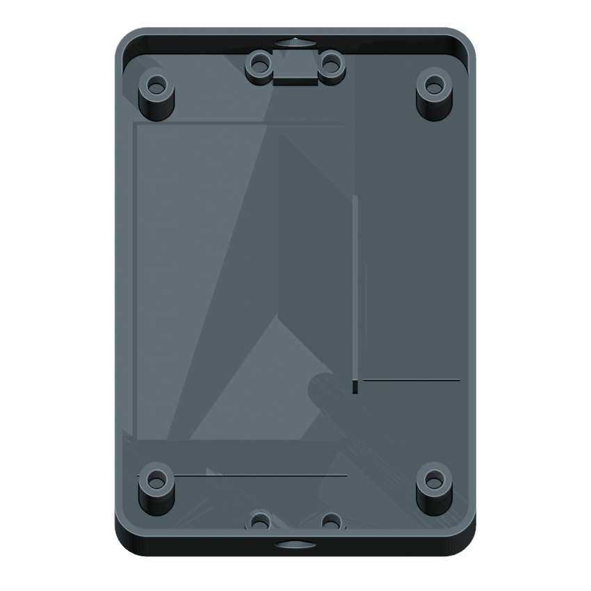 | 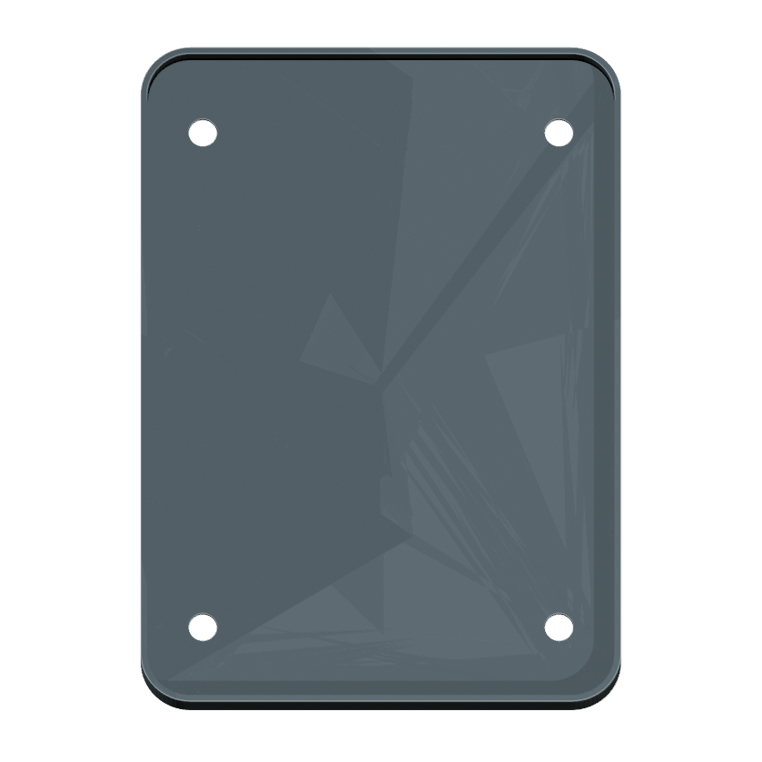 |

The longer platform accepts the supply. The smaller bay beside the divider accepts the converter. The gray blocks show reserved space including connector clearance.

The skirt overlaps the body wall by about 5 mm. The cable ports are open.

| Closed | Opposite end | Lid removed from posts |
|---|---|---|
|  |  |  |

Dimensions, assembly sequence and individual STL downloads

### Component bays and demonstration assembly

The open supply was estimated at **104 × 57–58 × 26 mm**. Height has the greatest uncertainty. The reserved supply bay is **110 × 65 × 32 mm**. The second bay reserves **50 × 30 × 20 mm** for the converter including its connectors. The gray solids in the gallery represent these component locations. PCB hole coordinates and production mounting hardware remain unspecified.

For an unpowered demonstration, place the component mock-ups in their bays, route the demonstration cables through the opposite ports and secure the jackets with the two clamps. Install the green lid with its four recessed screws. The 32 engraved rays sit above the solid lid. Its skirt overlaps the body by approximately 5 mm.

The ports are open and the lid has no gasket. Keep the demonstration electronics dry. No ingress rating, thermal test or outdoor mains operating approval has been established.

| Individual STL | Color | Quantity |
|---|---|---:|
| [Body](cases/suncronizer/print/stl/black/01_body_x1.stl) | Black | 1 |
| [Solar lid](cases/suncronizer/print/stl/green/02_solar-lid_x1.stl) | Green | 1 |
| [Lid screw](cases/suncronizer/print/stl/green/03_lid-screw_x4.stl) | Green | 4 |
| [Cable clamp](cases/suncronizer/print/stl/green/04_cable-clamp_x2.stl) | Green | 2 |
| [Clamp screw](cases/suncronizer/print/stl/black/05_clamp-screw_x4.stl) | Black | 4 |
| **Total** | | **12** |

[Edit this case in Blender or FreeCAD](cases/suncronizer/cad/)

## Printing on the P1S

All four case kits are designed for a **Bambu Lab P1S with a 256 × 256 mm plate and a 0.4 mm nozzle**. Each color has its own arranged 3MF. The intended setup is PLA, the **0.20 mm Strength** process and supports disabled. These files have passed digital bed-layout checks. Physical printing remains untested.

1. Identify the supply and check its dimensions, terminal projections and cable route against the [fit guide](docs/dimensions.md).
2. Download the matching print kit from [Releases](https://github.com/vluncasu/power-supply-cases/releases/latest) and extract it. Open one file from the plate folder at a time. For direct downloads from GitHub file pages, use **Download raw file**.
3. In your slicer select the P1S, 0.4 mm nozzle, build surface and actual filament. Import the plate at 100% in millimeters. The 3MF stores the geometry and copy counts. Select the process in the slicer and generate toolpaths locally.
4. Preserve the supplied orientation. Check that every object starts on the bed and preview the short bridges in the screwdriver slots, head recesses and threaded parts. Check clear space before adding a brim.
5. Print one plate per color. Change the spool between plates. The supplied layout needs no in-print color change. For replacements, each individual STL contains one part. Its xN suffix specifies the quantity for one complete enclosure.
6. Use the model-specific assembly order. Bring printed screws up gently by hand and check fit with an unpowered assembly.

| Case | Lid on the print bed | Plate 1 | Plate 2 |
|---|---|---:|---:|
| [Delta iMac 27″ Late 2015 Power Supply](cases/imac-27-5k-2015/) | Flat underside on bed, sculpted face up | 13 graphite | 11 ivory |
| [AURA S-60-12](cases/aura-s60/) | Exterior face down | 5 graphite | 7 ivory |
| [AURA Compact 160](cases/aura-compact-160/) | Exterior face down | 5 black | 9 white |
| [Suncronizer](cases/suncronizer/) | Engraved face down, skirt up | 5 black | 7 green |

Bodies print floor-down, screws head-down and cable clamps flat-side-down. Installed clamps face the jacket with their rounded ribs. For ARC, print the PCB shoes on the square bases and the nuts on a flat face. Separate printed hardware from different kits by model, even where the parts look similar.

## CAD verification and physical limits

| Design | Dimensional input | Digital check | Physical question |
|---|---|---|---|
| Delta iMac 27″ Late 2015 Power Supply | Photographic estimates of the Delta PCB | Mount travel, mating threads and isolated cable clamps | Actual hole coordinates, solder clearance and jacket retention |
| AURA S-60-12 | Supplied STEP assembly with 44 solids | Interference between enclosure parts and the reference metal supply | Production unit variation |
| AURA Compact 160 | Estimated metal housing dimensions | Two rectangular envelopes and adjustable hold-downs | Solid contact points and full cable bend |
| Suncronizer | Estimated supply and provisional converter size | Separation of two reserved volumes from body and lid | Converter selection, PCB mounting and water protection |

A zero common volume in a modeled position indicates no volumetric collision at the calculation precision. Near-zero residuals can occur at tangent faces. Friction, printer tolerances, thread strength and cable pull-out force require measurements. Cable checks use rigid local representations. Clearance at the port does not establish a viable route to the terminals.

Reported material comparisons sum CAD solid volumes multiplied by part quantities. Filament and print time depend on the slicer, wall count, infill, speeds and generated toolpaths. Slot and baffle areas describe geometry. Airflow and temperature under load were not measured.

## Mains and environmental limits

The iMac supply is an exposed mains assembly. Capacitors can retain charge after disconnection. Use the models for unpowered mechanical evaluation. Operation requires assessment of electrical isolation, access to live parts, protective earth where applicable, cable retention, temperatures and material suitability. Suncronizer is an unpowered demo with open ports and no assigned ingress rating. [iFixit power supply removal guide](https://www.ifixit.com/Guide/iMac+Intel+27-Inch+Retina+5K+Display+Power+Supply+Replacement/30530)

## Distribution checks

Each case includes JSON design reports and a print manifest recording the part ID, quantity, color and distribution path. The repository verifier reads the delivered STL and 3MF geometry, checks plate contents and compares published file hashes. [Verification script](tools/verify.py) · [How to run it](docs/cad.md)

How to modify a part and export it for printing

Open the case-specific **edit-parts.blend** and save a working copy. The body, lid and hardware are separate objects arranged in rows. Select a part, edit its faces, duplicate the result and reset the duplicate's location to zero. Export only that selection as STL at scale 1 with Scene Unit disabled. Check its dimensions in the slicer.

For the cable clamp, open **cable-clamp.FCStd** and select **Dimensions → Data**. Width, hole spacing, hole diameter and rib spacing can be changed numerically. Export the finished Body to STL or STEP after recomputing. [Worked example and export settings](docs/cad.md)

[Versions and citation](docs/publication.md)
