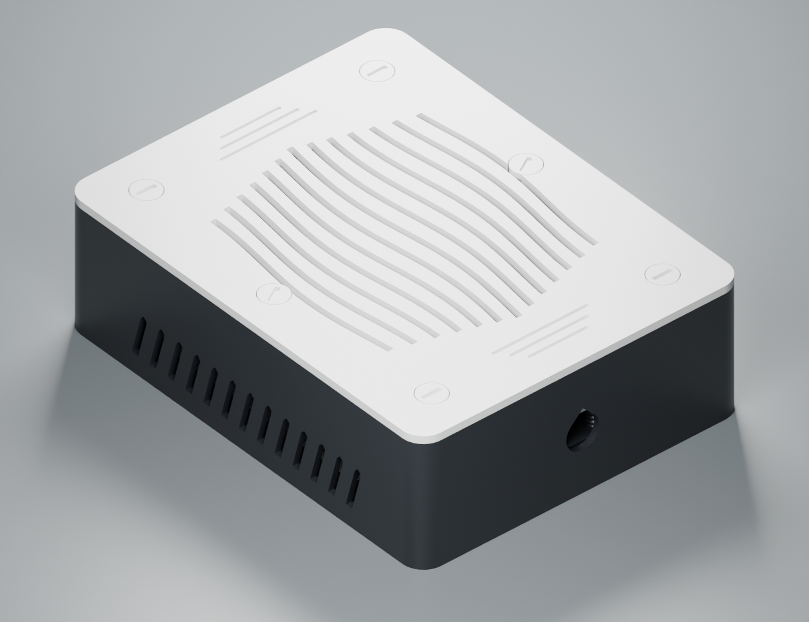

# AURA Compact 160

Bloc metalic estimat la 110 × 100 × 36 mm. Exterior **160 × 124 × 48,8 mm**.

[Vedere interioară](renders/interior.png)

## Imprimare

Plăci pregătite pentru P1S, duză 0,4 mm și strat de 0,20 mm, câte o culoare pe placă. [black ×5](print/plates/01-black-5.3mf) · [white ×9](print/plates/02-white-9.3mf)

3MF-urile includ toate exemplarele. Dacă imporți STL-urile, setează cantitățile de mai jos. [Instrucțiuni comune](../../docs/printing.md)

| Piesă STL | Filament | Exemplare |
|---|---|---:|
| [body](print/stl/black/01_body_x1.stl) | black | 1 |
| [wave-lid](print/stl/white/02_wave-lid_x1.stl) | white | 1 |
| [lid-screw](print/stl/white/03_lid-screw_x4.stl) | white | 4 |
| [cable-clamp](print/stl/white/04_cable-clamp_x2.stl) | white | 2 |
| [clamp-screw](print/stl/black/05_clamp-screw_x4.stl) | black | 4 |
| [hold-down-screw](print/stl/white/06_hold-down-screw_x2.stl) | white | 2 |
| **Total** | | **14** |

## Proiectare și montaj

Gabaritul rezervat în CAD este de **112 × 102 × 38 mm**. Dimensiunile piesei fizice au fost estimate. Confirmă lungimea inclusiv proeminențele bornelor. Capetele șuruburilor de presare pot ridica înălțimea totală la 50,8 mm pentru sursa de 38 mm.

Față de varianta anterioară de 184 × 132 mm, amprenta s-a redus cu 18,3%. La borne rămân aproximativ 13,7 mm până la bridă. Culoarul lateral DC are aproximativ 5,2 mm la ghidaje. Un cablu gros poate încăpea în port fără să poată parcurge coturile interioare. Verifică traseul cu cablul real. [Comparația CAD](validation/comparison.json)

Păstrează învelișul metalic al sursei. Așază bornele către intrare, fixează mantalele și închide capacul cu șuruburile periferice. Reglează cele două șuruburi scurte numai dacă ating metal solid. Punctele nominale de contact sunt X = ±48 mm, Y = −2 mm față de centrul carcasei. Modelul gri din interior reprezintă volumul estimat.

Imprimă capacul cu exteriorul pe pat. Corpul stă pe fund, șuruburile pe cap și bridele pe fața plată.

[Fișier Blender](cad/assembly.blend) · [Generatorul geometriei](source/build.py) · [Rapoarte CAD](validation/) · [Metodă și limite](../../docs/method.md)
