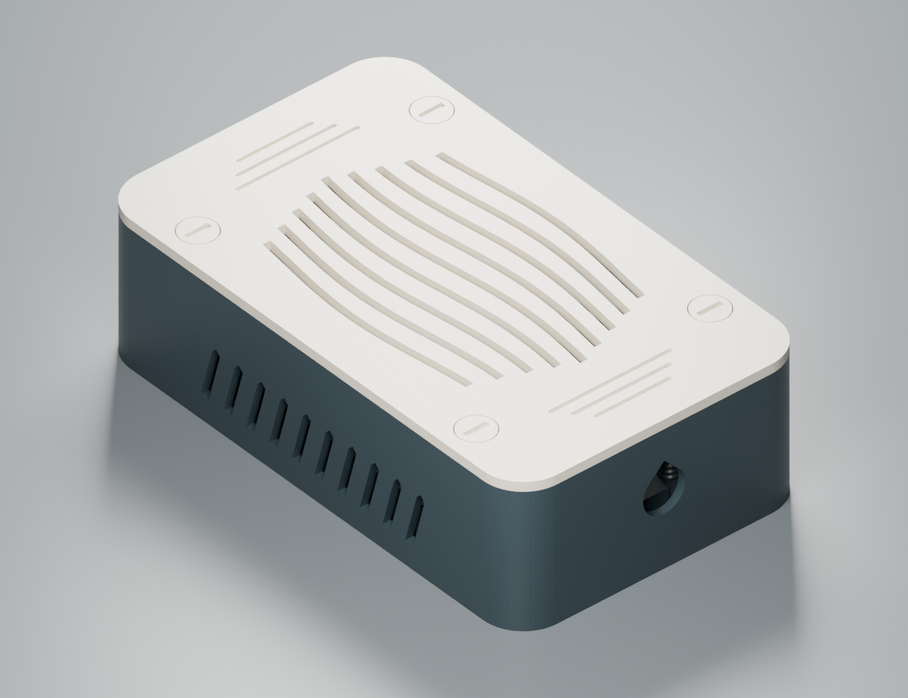

# AURA S-60-12

S-60-12 din modelul STEP, 86 × 58,02 × 33,02 mm. Exterior **148 × 88 × 42,8 mm**.

[Vedere interioară](renders/interior.png)

## Imprimare

Plăci pregătite pentru P1S, duză 0,4 mm și strat de 0,20 mm, câte o culoare pe placă. [graphite ×5](print/plates/01-graphite-5.3mf) · [ivory ×7](print/plates/02-ivory-7.3mf)

3MF-urile includ toate exemplarele. Dacă imporți STL-urile, setează cantitățile de mai jos. [Instrucțiuni comune](../../docs/printing.md)

| Piesă STL | Filament | Exemplare |
|---|---|---:|
| [body](print/stl/graphite/01_body_x1.stl) | graphite | 1 |
| [wave-lid](print/stl/ivory/02_wave-lid_x1.stl) | ivory | 1 |
| [lid-screw](print/stl/ivory/03_lid-screw_x4.stl) | ivory | 4 |
| [cable-clamp](print/stl/ivory/04_cable-clamp_x2.stl) | ivory | 2 |
| [clamp-screw](print/stl/graphite/05_clamp-screw_x4.stl) | graphite | 4 |
| **Total** | | **12** |

## Proiectare și montaj

Potrivirea a fost evaluată pe modelul STEP de referință. Identificatorul comercial S-60-12 apare pe surse cu gabarite diferite. Verifică dimensiunile sursei fizice și poziția bornelor înainte de a alege această carcasă. [Raport de intersecție cu modelul de referință](validation/reference_fit.json)

Sursa își păstrează carcasa metalică. Cele patru platforme și opritoarele limitează mișcarea. Jocul vertical nominal este de aproximativ 0,18 mm, deci toleranțele imprimării și ale piesei reale pot influența închiderea. Capacul ondulat și admisiile laterale păstrează un traseu pentru aer. Nu există măsurători de temperatură în sarcină.

Așază bornele către intrarea AC. Ieșirea DC ajunge la capătul opus prin culoarul lateral proiectat pentru aproximativ Ø5–8 mm. Montează bridele pe mantale, apoi capacul cu cele patru șuruburi. Imprimă exteriorul capacului pe pat, șuruburile pe cap și bridele pe fața plată.

Fișierul Blender conține piesele carcasei în orientarea de imprimare, suprapuse la origine. Selectează individual piesele pentru editare. Modelul comercial de referință provenit din fișierul STEP nu este redistribuit.

[Fișier Blender](cad/parts.blend) · [Generatorul geometriei](source/build.py) · [Rapoarte CAD](validation/) · [Metodă și limite](../../docs/method.md)
