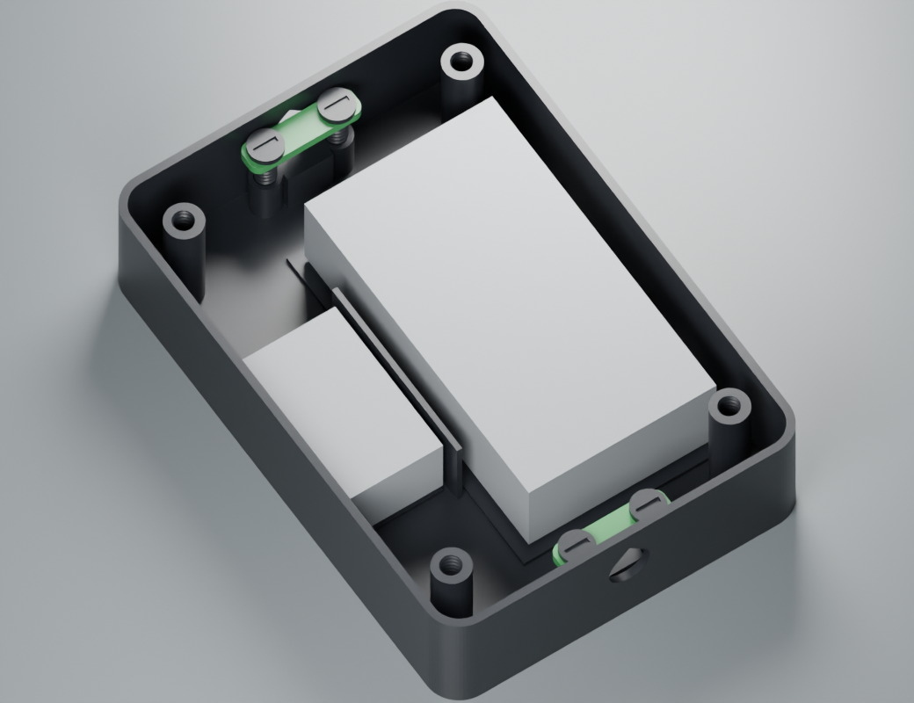
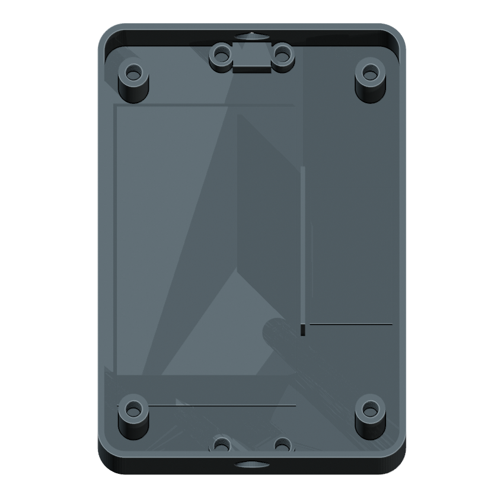
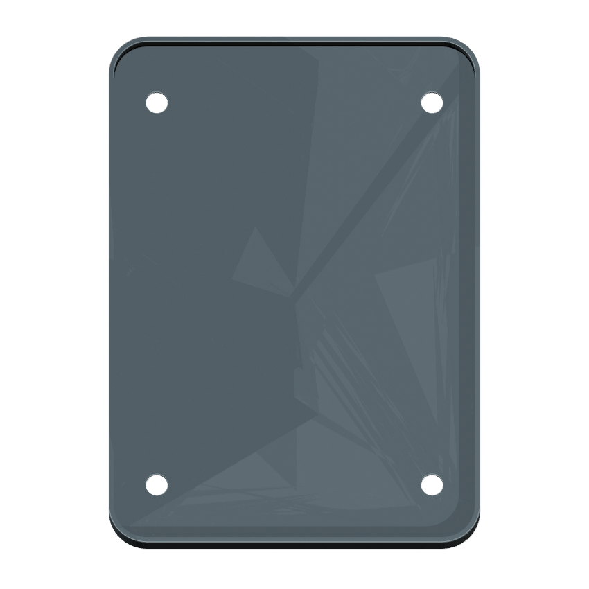
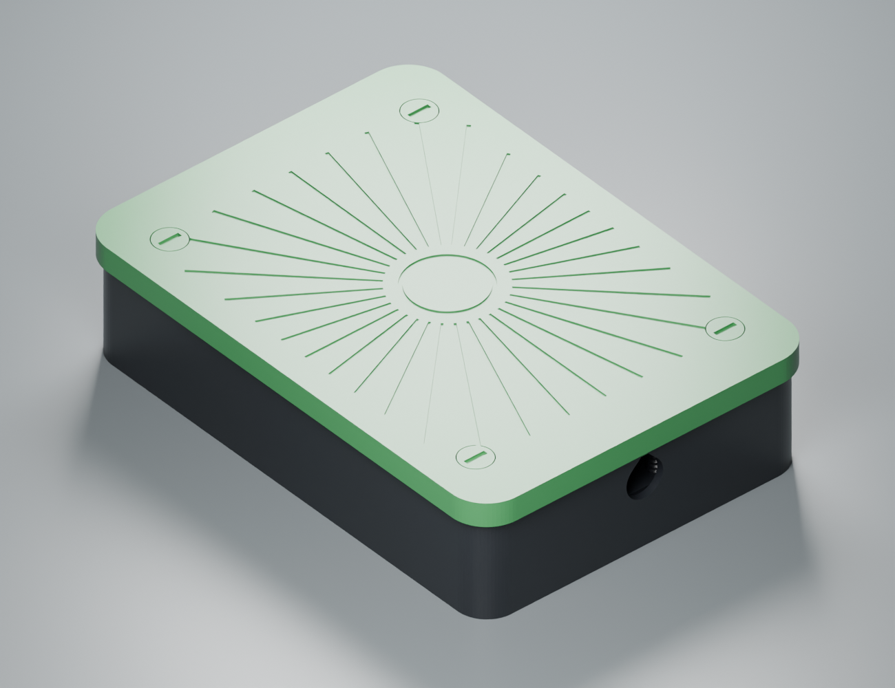
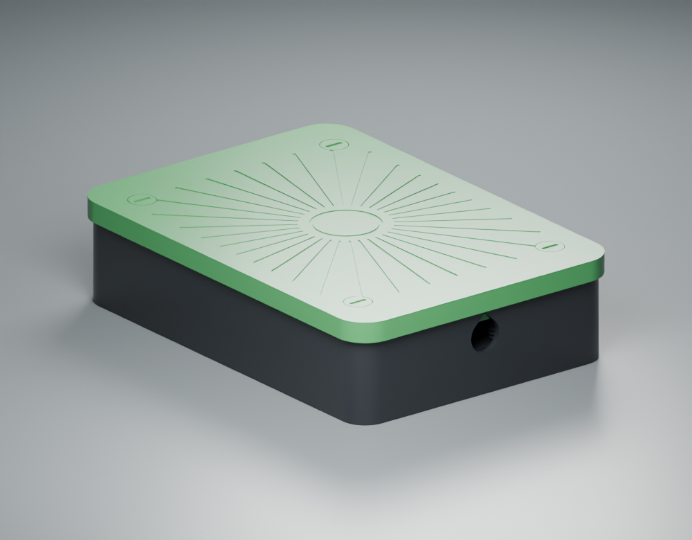
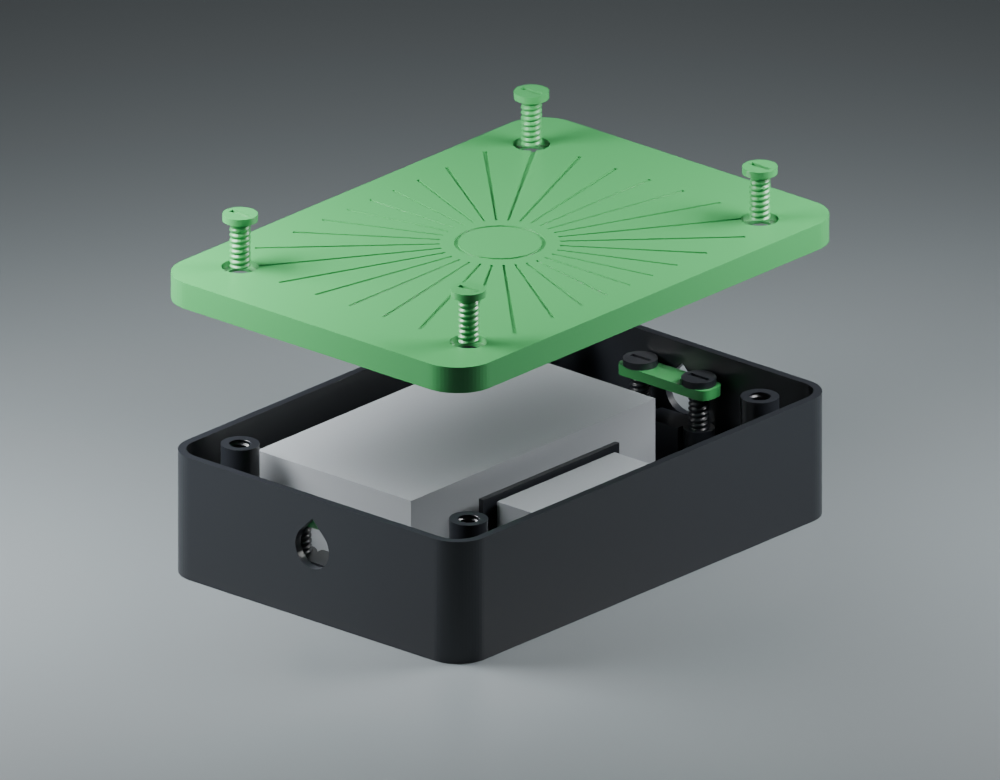

# Suncronizer

An unpowered solar tracker demo. The case measures **164 × 116 × 39.8 mm** and has separate spaces for the supply and converter.

[Print ZIP](https://github.com/vluncasu/power-supply-cases/releases/latest/download/suncronizer-print.zip) · [CAD + print ZIP](https://github.com/vluncasu/power-supply-cases/releases/latest/download/suncronizer-cad.zip) · [Black plate ×5](print/plates/01-black-5.3mf) · [Green plate ×7](print/plates/02-green-7.3mf)

| Bare base | Underside of lid |
|---|---|
|  |  |

The longer platform accepts the supply. The smaller bay beside the divider accepts the converter. The gray blocks show reserved space including connector clearance.

The skirt overlaps the body wall by about 5 mm. The cable ports are open.

| Closed | Opposite end | Lid removed from posts |
|---|---|---|
|  |  |  |

## Edit the design

[Complete CAD kit](https://github.com/vluncasu/power-supply-cases/releases/latest/download/suncronizer-cad.zip) · [Edit all parts in Blender](cad/edit-parts.blend) · [Parametric clamp](cad/cable-clamp.FCStd) · [Clamp STEP](cad/cable-clamp.step) · [Lid STEP](cad/lid.step)

Open the Blender parts file to select an individual body, lid or fastener. Use the Dimensions object in FreeCAD to change the clamp width or screw clearances. [Step-by-step editing and STL export](../../docs/cad.md)

## Print on a Bambu Lab P1S

Designed for the **256 × 256 mm P1S bed, 0.4 mm nozzle, 0.20 mm Strength profile and supports disabled**. Each geometric 3MF contains all copies for one filament color. [Black plate (5 pieces)](print/plates/01-black-5.3mf) · [Green plate (7 pieces)](print/plates/02-green-7.3mf)

Print the engraved lid exterior face down with its skirt rising from the bed. Place the body on its floor, screws on their heads and clamps flat side down. The separate STL files each contain one part. Use the quantities below when importing them individually. [Slicer setup and first-layer checks](../../docs/printing.md)

| Individual STL | Color | Quantity |
|---|---|---:|
| [Body](print/stl/black/01_body_x1.stl) | Black | 1 |
| [Solar lid](print/stl/green/02_solar-lid_x1.stl) | Green | 1 |
| [Lid screw](print/stl/green/03_lid-screw_x4.stl) | Green | 4 |
| [Cable clamp](print/stl/green/04_cable-clamp_x2.stl) | Green | 2 |
| [Clamp screw](print/stl/black/05_clamp-screw_x4.stl) | Black | 4 |
| **Total** | | **12** |

### Component bays and demonstration assembly

The open supply was estimated at **104 × 57–58 × 26 mm**. Height has the greatest uncertainty. The reserved supply bay is **110 × 65 × 32 mm**. The second bay reserves **50 × 30 × 20 mm** for the converter including its connectors. The gray solids in the gallery represent these component locations. PCB hole coordinates and production mounting hardware remain unspecified.

For an unpowered demonstration, place the component mock-ups in their bays, route the demonstration cables through the opposite ports and secure the jackets with the two clamps. Install the green lid with its four recessed screws. The 32 engraved rays sit above the solid lid. Its skirt overlaps the body by approximately 5 mm.

The ports are open and the lid has no gasket. Keep the demonstration electronics dry. No ingress rating, thermal test or outdoor mains operating approval has been established.

[Editable Blender file](cad/assembly.blend) · [CAD reports](validation/) · [Evidence and limitations](../../docs/method.md)
