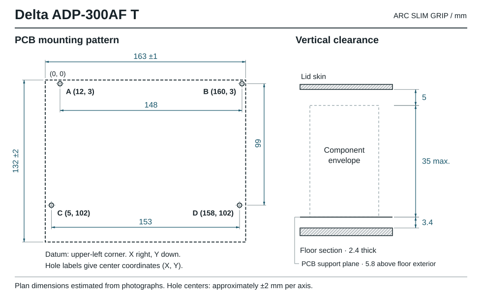

# Dimensiunile surselor și compatibilitatea mecanică

Cotele sunt în milimetri, în ordinea **lungime × lățime × înălțime**. Compară eticheta și toate cele trei dimensiuni cu piesa ta. La o sursă deschisă contează atât componentele înalte, cât și lipiturile de sub PCB. La o sursă închisă contează și bornele sau capetele de șurub care ies din înveliș.

| Carcasă | Piesă pentru care a fost proiectată | Gabarit folosit în CAD | Exteriorul carcasei imprimate |
|---|---|---|---|
| [ARC Slim Grip](../cases/imac-27-5k-2015/) | Delta ADP-300AF T, PCB estimat **163 × 132**, componente de circa **30** înălțime | **164 × 134** pentru placă, **35** deasupra planului de montaj | **190 × 166 × 50**, inclusiv picioarele |
| [AURA Compact 160](../cases/aura-compact-160/) | Sursă cu înveliș metalic, aproximativ **110 × 98–100 × 35–36** | Volum de control **112 × 102 × 38** | **160 × 124 × 48,8**. Șuruburile de presare pot ajunge la **50,8** |
| [AURA S-60-12](../cases/aura-s60/) | Ansamblul metalic S-60-12 din fișierul STEP furnizat | Limitele geometriei STEP sunt **86 × 58,02 × 33,02** | **148 × 88 × 42,8** |
| [Suncronizer](../cases/suncronizer/) | Placă estimată la **104 × 57–58 × 26** și convertitor separat 12 V → 5 V | **110 × 65 × 32** pentru sursă și **50 × 30 × 20** rezervați convertitorului | **164 × 116 × 39,8**, inclusiv marginea capacului |

## Delta ADP-300AF T pentru iMac Retina 5K de 27″, Late 2015

Modelul gazdă este A1419, iMac17,1. Catalogul de piese leagă codul Apple **661-03524** de sursa de **300 W** și listează variante Delta și Lite-On. Carcasa ARC a fost calculată pe geometria estimată a variantei Delta. Pentru alegerea fișierelor de imprimat, citește și codul producătorului de pe piesă. [Apple, identificarea sistemului](https://support.apple.com/en-gb/108054) · [Beetstech, piesa 661-03524](https://beetstech.com/product/imac-27-inch-a1419-300w-power-supply-661-03524)

| Mărime | Estimarea din fotografii | Consecință pentru proiect |
|---|---|---|
| Lungime PCB | 163 ± 1 | Dimensiune de calcul 164 |
| Lățime PCB | 132 ± 2 | Dimensiune de calcul 134 |
| Înălțime maximă estimată | 30 ± 5 | Calcul cu 35 de la planul de montaj |
| Diametru interior al găurilor | 3,5–4 | Ax imprimat nominal Ø3,2 |
| Diametru exterior al inelului metalic | aproximativ 8 | Platformă Ø9. Verifică zona de contact pe ambele fețe |

Originea este colțul stânga-sus al plăcii în orientarea din figură. X crește către dreapta, Y către marginea de jos. Centrele estimate sunt **A (12, 3), B (160, 3), C (5, 102), D (158, 102)**, cu incertitudine estimată la circa ±2 pe coordonată. Rezultă deschideri orizontale A–B de 148 și C–D de 153. Diferența dintre rânduri pe axa Y este 99. Găurile A/C și B/D au coordonate X diferite. Suporturile mobile compensează abateri mici în ambele axe.

Planul de montaj este la 5,8 deasupra fundului exterior. Calculul pe verticală este **5,8 + 35 + 5 = 45,8** până la plafonul interior. În zona podelei de 2,4 rămân nominal **3,4 sub placă**. Compară această distanță cu lipiturile și piesele care coboară sub PCB. Cele două treceri pentru cablu au secțiunea circulară Ø12,6, iar verificările digitale ale bridelor acoperă mantale rotunde Ø4–12. Spațiile libere sunt cote mecanice. Siguranța electrică și răcirea la sarcină nu au fost validate.

## Alte trei situații de montaj

**AURA Compact 160.** Lungimea de 110 a fost estimarea cea mai incertă. Găurile vizibile au fost estimate la 75–80 între centre. Modelul folosește opritoare și două șuruburi de presare pe metal solid. Pentru gabaritul maxim, între capătul dinspre borne și bridă sunt aproximativ 13,7. Verifică proeminența bornelor și traseul lateral al ieșirii DC înainte de imprimare.

**AURA S-60-12.** Cotele cu două zecimale provin din limitele întregului ansamblu STEP de referință. Precizia numerică a modelului nu stabilește toleranța de fabricație a unei surse comerciale. Varianta AURA Compact de 110 mm are altă geometrie și alte opritoare.

**Suncronizer.** Înălțimea de 26 a sursei este cota cu cea mai mare incertitudine. Dimensiunea convertitorului este o alocare de spațiu, iar modelul concret trebuie verificat cu conectorii montați. Configurația este o machetă pentru prezentare fără alimentare la rețea. Pozițiile găurilor de fixare ale PCB-urilor rămân necunoscute.

[Rezultatele verificărilor și proveniența datelor](method.md) · [Orientarea și multiplicarea pieselor](printing.md)
